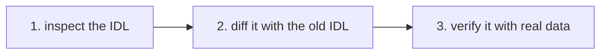

# Quick guide

- `idl-drift` compares two versions of a Solana program IDL. It finds the changes that break
  a parser generated from the old version.
- `idl-verify` checks one IDL against real account, instruction and event data.



## Install

You need Rust 1.91 or newer. The clone gives you the fixture files that the commands below use.

```bash
cargo install --locked --git https://github.com/senzenn/idl-drift idl-drift
cargo install --locked --git https://github.com/senzenn/idl-drift idl-verify
git clone https://github.com/senzenn/idl-drift && cd idl-drift
```

## Run

```bash
# 1. Make sure that idl-drift can read each field. An UNMAPPED: line names a field that neither tool can check.
idl-drift inspect fixtures/live/voltr_vault/idl.json

# 2. Compare two versions. A Breaking change gives exit 1. Add --fail-on dangerous or --json as needed.
idl-drift diff crates/idl-drift/tests/fixtures/amm_old.json crates/idl-drift/tests/fixtures/amm_new.json

# 3. Check an IDL against captured samples. This Codama conversion drops 7 bytes of padding: exit 1.
idl-verify --idl fixtures/live/voltr_vault/idl.js-codama.json --samples fixtures/live/voltr_vault/samples.json

# 4. Check an IDL against live mainnet data, at the IDL's address. Keep the URL off the command line.
export IDL_VERIFY_RPC_URL=<your mainnet RPC URL>
idl-verify --idl path/to/idl.json --save-samples samples.json   # run again offline with --samples
```

The diff in step 2 prints:

```text
  [BREAKING] FIELD changed (Pool#1) via reachable type: feeBps: u16 -> u32 (Borsh layout)
  [DANGEROUS] new account on instruction (swap#2): a parser built from the new IDL reads it by index, so it fails on a transaction without it
  [ADDITIVE] new instruction: collectFees
summary: 1 breaking, 1 dangerous, 1 additive, 0 cosmetic
exit code: 1
```

## Exit codes

| Code | Meaning |
|---|---|
| `0` | No finding at or above `--fail-on`. |
| `1` | At least one finding at or above `--fail-on`. For `inspect`: a field that cannot be resolved, or a padded zero-copy type that Borsh also reads. |
| `2` | The tool could not run: a file could not be read or parsed, an option is wrong, or (idl-verify) the RPC or decoder failed or nothing was sampled. |

## Next

- Run both tools in CI: [docs/ci.md](docs/ci.md).
- Each rule, check and option: [idl-drift](docs/idl-drift.md), [idl-verify](docs/idl-verify.md).
- Test your generated parser: [docs/decoder-protocol.md](docs/decoder-protocol.md).
