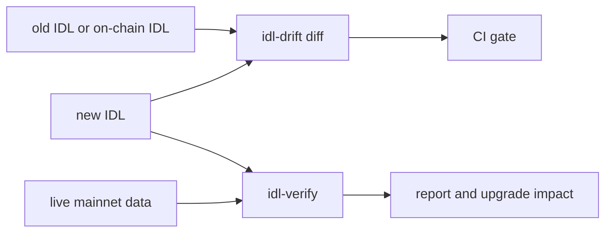

# idl-drift

Find the Solana IDL changes that make parsers, indexers and clients read the wrong bytes.
Find them before your users do.

**Status:** 0.1.0 is not released. Rule names, check names, JSON keys and exit codes are
stable.

## The problem

A parser that is generated from an IDL reads bytes at fixed positions. It does not check
the IDL against the program. When the two do not agree, the parser decodes the wrong bytes
into values that look correct. No error occurs, so the problem shows up later, as wrong data
or a crash in a user's app.

This is common:

- A program upgrade often comes with no update to the IDL that the program publishes on
  chain. In a check of 49 widely used mainnet programs on 2026-10-15, 36 published an IDL
  on chain. For 22 of them, the IDL was older than the deployed code. The median gap was 191
  days.
- An SDK can ship an old IDL. The marginfi SDK fails on 7 of 188 live banks because its IDL
  does not have a new enum variant
  ([mrgn-ts#1139](https://github.com/mrgnlabs/mrgn-ts/issues/1139)).
- A conversion can change the layout. `npx codama convert` removes the `repr(C)` padding from
  a voltr_vault account type. A parser built from the converted IDL reads 145 of the 152
  bytes, and each field after the gap is read 7 bytes too early.

## Who it is for

| You maintain | Your risk | Use |
|---|---|---|
| A parser, decoder or indexer (for example with Shipstern or Carbon) | A program upgrade breaks your decoder with no error. | A nightly `idl-verify` run on live data, and `idl-drift diff --onchain`. |
| A Solana program | A release breaks the clients, indexers and SDKs of your users. | `idl-drift diff` on each pull request, and `--upgrade-impact` before a deploy. |
| A Codama IDL made from an Anchor IDL | The conversion moves a field or drops padding. | `idl-drift diff anchor.json codama.json`, then `idl-verify`. |

## What it does

There are two tools:

- **`idl-drift`** compares two versions of an IDL. It puts each change in a tier by its
  effect on a parser built from the old version: Breaking, Dangerous, Additive or Cosmetic.
- **`idl-verify`** checks one IDL against real account, instruction and event data from the
  program. It counts the bytes that the IDL does not read, so it finds a missing field even
  when the decoded values look correct.

Both tools read Anchor IDLs (0.30 spec and legacy) and Codama IDLs (spec 1.x). Both use the
same exit codes: 0 when clean, 1 on a finding, 2 when the tool cannot run.



### 1. Compare two versions of an IDL

```bash
idl-drift diff old.json new.json
```

```text
  [BREAKING] FIELD changed (Pool#1) via reachable type: feeBps: u16 -> u32 (Borsh layout)
  [DANGEROUS] new account on instruction (swap#2): a parser built from the new IDL reads it by index, so it fails on a transaction without it
  [ADDITIVE] new instruction: collectFees
summary: 1 breaking, 1 dangerous, 1 additive, 0 cosmetic
exit code: 1
```

### 2. Compare your new IDL with the IDL on chain

The old version is the IDL that the program publishes, in its Program Metadata account or
its Anchor IDL account. Keep the RPC URL out of the command line.

```bash
export IDL_DRIFT_RPC_URL=<your RPC URL>
idl-drift diff --onchain <PROGRAM_ID> target/idl/my_program.json
```

### 3. Check an IDL against mainnet data

```bash
export IDL_VERIFY_RPC_URL=<your RPC URL>
idl-verify --idl idl.json
```

```text
error: account adaptorAddReceipt: 7 of 152 bytes unused in 5 of 5 samples
  hint: 152 bytes is exactly the repr(C) layout (8 + 144), which pads 7 bytes before `lastUpdatedEpoch`. ...
```

### 4. Measure the upgrade impact before a deploy

`--upgrade-impact` reads the live accounts of the program with the new IDL. It counts the
accounts that break or need a realloc, and the extra rent.

```bash
idl-verify --idl new.json --upgrade-impact
```

```text
  type                 sampled  ok  shorter  broken  realloc  bytes  rent each
  ...
  Vault                      5   0        0       0        5      8  40640
  total                     16  11        0       0        5
extra rent for the 5 accounts that need a realloc: 203200 lamports, ...
```

## Install

You need Rust 1.91 or newer.

```bash
git clone https://github.com/senzenn/idl-drift && cd idl-drift
cargo install --locked --path crates/idl-drift
cargo install --locked --path crates/idl-verify
```

The [quick guide](QUICKGUIDE.md) runs each tool on the fixtures in this repository.

## Use it in CI

The GitHub Action runs either tool in one step and writes the report to the job summary.
It works after the first release (v0.1.0).

```yaml
- uses: actions/checkout@3d3c42e5aac5ba805825da76410c181273ba90b1 # v7.0.1
- uses: senzenn/idl-drift@v0.1.0
  with:
    idl: idls/my_program.json
```

On a pull request, this compares the IDL with its version on the base branch. See
[docs/ci.md](docs/ci.md) for the nightly `idl-verify` job, the allow file and the inputs.

## Limits

- The tools read IDLs, not program source code. A change that the IDL does not show is not
  found.
- Live sampling sees recent transactions only. Instructions and account types that nobody
  uses in that window are not checked.
- For Shank IDLs (for example Metaplex and Phoenix), the tools check instructions only.
  Shank accounts have no discriminator.

The full lists are in [idl-drift](docs/idl-drift.md#limitations) and
[idl-verify](docs/idl-verify.md#limitations).

## Documentation

| Page | Content |
|---|---|
| [Quick guide](QUICKGUIDE.md) | Install, the first commands, exit codes. |
| [idl-drift reference](docs/idl-drift.md) | Commands, tiers, each diff rule, rule names, JSON format. |
| [idl-verify reference](docs/idl-verify.md) | Options, checks, samples format, live sampling, upgrade impact, limitations. |
| [Decoder protocol](docs/decoder-protocol.md) | Test a generated parser with `--decoder`. |
| [CI](docs/ci.md) | The GitHub Action and example workflows for both tools. |
| [Architecture](docs/architecture.md) | Crates, parts and data flow. |
| [Contributing](CONTRIBUTING.md) | Setup, checks, tests, and how to add a rule or a check. |
| [Security](SECURITY.md) | How to report a security problem. |
| [Changelog](CHANGELOG.md), [Roadmap](ROADMAP.md) | Releases and planned work. |

## License

The code is licensed under either of [Apache-2.0](LICENSE-APACHE) or [MIT](LICENSE-MIT), at
your option.

The IDLs and samples in `fixtures/` and in the test fixture directories belong to the
authors of their programs. This license does not cover them, and the published crates do
not include them.
