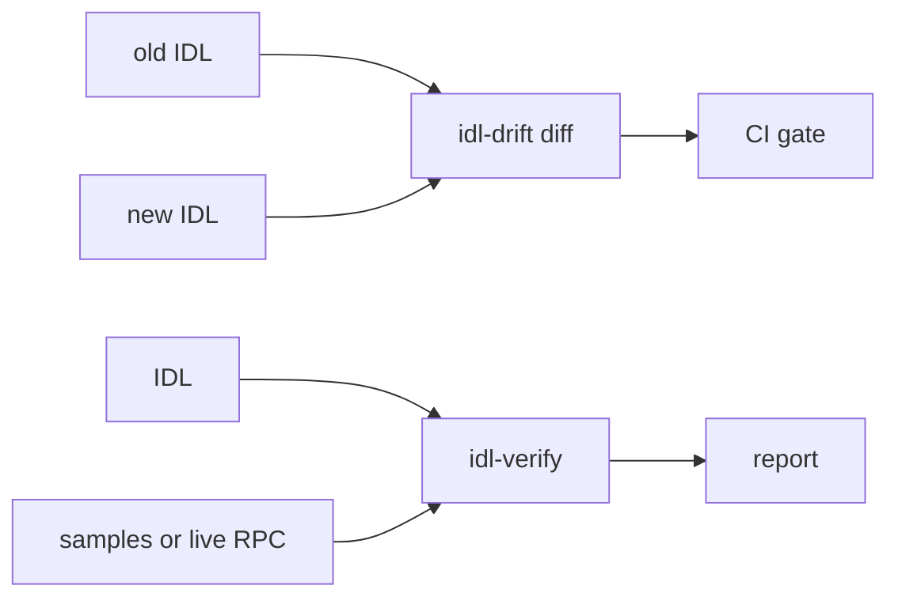

# idl-drift

Command-line checks for Solana program IDLs. They find an IDL that makes a generated parser
read the wrong bytes with no error.

**Status:** 0.1.0 is not released. Rule names, check names, JSON keys and exit codes are
stable.

- **`idl-drift`** compares two versions of an IDL. It puts each change in a tier, by its
  effect on a parser that was generated from the old version. With `--onchain`, the old
  version is the IDL that the program publishes on chain.
- **`idl-verify`** checks one IDL against real account, instruction and event data from the
  program.

Both tools read Anchor IDLs (0.30 spec and legacy) and Codama IDLs (spec 1.x). Both use the
same exit codes, so CI can use each one as a gate. Each tool has limits: see the limitations
of [idl-drift](docs/idl-drift.md#limitations) and [idl-verify](docs/idl-verify.md#limitations).



## Install and run

You need Rust 1.91 or newer. The last two commands run on fixtures in the repository, and each one
exits 1.

```bash
git clone https://github.com/senzenn/idl-drift && cd idl-drift
cargo install --locked --path crates/idl-drift
cargo install --locked --path crates/idl-verify
idl-drift diff crates/idl-drift/tests/fixtures/amm_old.json crates/idl-drift/tests/fixtures/amm_new.json
idl-verify --idl fixtures/live/voltr_vault/idl.js-codama.json --samples fixtures/live/voltr_vault/samples.json
```

The diff finds a Breaking change. The check finds 7 bytes that the Codama IDL does not read
(see [Why](#why)). The [quick guide](QUICKGUIDE.md) explains each step and the exit codes.

## Why

A parser generated from an IDL, such as one from Shipstern's `include_shipstern_parser!`,
reads bytes at fixed positions and does not check the IDL. When the IDL and the program do
not agree, the parser decodes the wrong bytes into a value that looks correct.

A real example: `npx codama convert` removes the implicit `repr(C)` padding from the
voltr_vault type `AdaptorAddReceipt`. Each sampled mainnet account of this type has 152
bytes. A parser generated from the converted IDL reads only 145 of them, and reads each
field after a 7-byte gap at the wrong offset. No error occurs. `idl-verify` reports it:

```text
error: account adaptorAddReceipt: 7 of 152 bytes unused in 5 of 5 samples
  hint: 152 bytes is exactly the repr(C) layout (8 + 144), which pads 7 bytes before `lastUpdatedEpoch`. ...
```

## Documentation

| Page | Content |
|---|---|
| [Quick guide](QUICKGUIDE.md) | Install, the first commands, exit codes. |
| [idl-drift reference](docs/idl-drift.md) | Commands, tiers, each diff rule, rule names, JSON format. |
| [idl-verify reference](docs/idl-verify.md) | Options, checks, samples format, live sampling, JSON format, limitations. |
| [Decoder protocol](docs/decoder-protocol.md) | Test a generated parser with `--decoder`. |
| [CI](docs/ci.md) | GitHub Actions workflows for both tools. |
| [Architecture](docs/architecture.md) | Crates, parts and data flow. |
| [Contributing](CONTRIBUTING.md) | Setup, checks, tests, and how to add a rule or a check. |
| [Security](SECURITY.md) | How to report a security problem. |
| [Changelog](CHANGELOG.md), [Roadmap](ROADMAP.md) | Releases and planned work. |

## License

The code is licensed under either of [Apache-2.0](LICENSE-APACHE) or [MIT](LICENSE-MIT), at
your option.

The IDLs and samples in `fixtures/` and in the test fixture directories belong to the
authors of their programs. This license does not cover them, and the published crates do
not include them.
