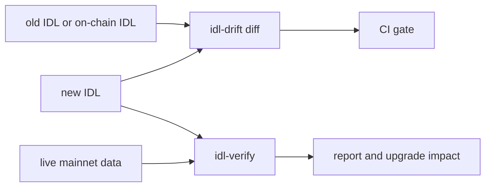

# idl-drift

Find the Solana IDL changes that make parsers, indexers and clients read the wrong bytes.
Find them before your users do.

**Status:** 0.3.0 is the current release. Rule names, check names, JSON keys and exit codes
are stable.

## The problem

A parser that is generated from an IDL reads bytes at fixed positions. It does not check
the IDL against the program. When the two do not agree, the parser decodes the wrong bytes
into values that look correct. No error occurs, so the problem shows up later, as wrong data
or a crash in a user's app.

This is common:

- A program upgrade often comes with no update to the IDL that the program publishes on
  chain. In a check of 49 widely used mainnet programs on 2026-10-15, 36 published an IDL
  on chain. For 22 of them, the IDL was older than the deployed code. The median gap was 191
  days.
- An SDK can ship an old IDL. The marginfi SDK fails on 7 of 188 live banks because its IDL
  does not have a new enum variant
  ([mrgn-ts#1139](https://github.com/mrgnlabs/mrgn-ts/issues/1139)).
- A conversion can change the layout. `npx codama convert` removes the `repr(C)` padding from
  a voltr_vault account type. A parser built from the converted IDL reads 145 of the 152
  bytes, and each field after the gap is read 7 bytes too early.

## Who it is for

| You maintain | Your risk | Use |
|---|---|---|
| A parser, decoder or indexer (for example with Shipstern or Carbon) | A program upgrade breaks your decoder with no error. | A nightly `idl-verify` run on live data, and `idl-drift diff --onchain`. |
| A Solana program | A release breaks the clients, indexers and SDKs of your users. | `idl-drift diff` on each pull request, and `--upgrade-impact` before a deploy. |
| A Codama IDL made from an Anchor IDL | The conversion moves a field or drops padding. | `idl-drift diff anchor.json codama.json`, then `idl-verify`. |

The [user guide](https://github.com/senzenn/idl-drift/blob/main/docs/user-guide.md) gives the steps for each case, with the real GitHub issues behind it.

## What it does

There are two tools:

- **`idl-drift`** compares two versions of an IDL. It puts each change in a tier by its
  effect on a parser built from the old version: Breaking, Dangerous, Additive or Cosmetic.
- **`idl-verify`** checks one IDL against real account, instruction and event data from the
  program. It counts the bytes that the IDL does not read, so it finds a missing field even
  when the decoded values look correct.

Both tools read Anchor IDLs (0.30 spec and legacy), Codama IDLs (spec 1.x) and Shank IDLs.



## Install

You need Rust 1.91 or newer.

```bash
cargo install --locked idl-drift idl-verify
```

To build the latest commit on `main`:

```bash
cargo install --locked --git https://github.com/senzenn/idl-drift idl-drift idl-verify
```

Binaries for Linux and macOS (x86_64 and arm64) are on the
[releases page](https://github.com/senzenn/idl-drift/releases).

The commands in [Quick start](#quick-start) use the fixture files of this repository. Clone
it to run them:

```bash
git clone https://github.com/senzenn/idl-drift && cd idl-drift
```

## Quick start

### 1. Make sure that the tools can read each field

```bash
idl-drift inspect fixtures/live/voltr_vault/idl.json
```

```text
instructions: 28  accounts: 6  events: 26  types: 44
unmapped (Generic) fields: 0
undefined types: 0
padded zero-copy types also read as Borsh: 0
instructions that Shipstern cannot tell apart: 0
account types that Shipstern skips: 0
```

An `UNMAPPED:` line names a field that neither tool can check. An `UNDEFINED:` line names a
type that the IDL uses but does not define. A `SHIPSTERN:` line names instructions or account
types that Shipstern's generated parser cannot use, although the IDL is valid.

### 2. Compare two versions of an IDL

```bash
idl-drift diff crates/idl-drift/tests/fixtures/amm_old.json crates/idl-drift/tests/fixtures/amm_new.json
```

```text
  [BREAKING] FIELD changed (Pool#1) via reachable type: feeBps: u16 -> u32 (Borsh layout)
  [DANGEROUS] new account on instruction (swap#2): a parser built from the new IDL reads it by index, so it fails on a transaction without it
  [ADDITIVE] new instruction: collectFees
summary: 1 breaking, 1 dangerous, 1 additive, 0 cosmetic
exit code: 1
```

`--fail-on dangerous` also fails on Dangerous changes. `--json` and `--markdown` print the
report for a script or a job summary.

### 3. Compare your new IDL with the IDL on chain

The old version is the IDL that the program publishes, in its Program Metadata account or
its Anchor IDL account. Keep the RPC URL out of the command line.

```bash
export IDL_DRIFT_RPC_URL=<your RPC URL>
idl-drift diff --onchain <PROGRAM_ID> target/idl/my_program.json
```

### 4. Check the program id of an Anchor workspace

Anchor keeps the program id in `declare_id!`, in `Anchor.toml` and in the IDL `address`.
`idl-drift source` checks that they agree for each program. With `--onchain`, it also checks
that the program is deployed at its `declare_id!`, and that its on-chain IDL gives the same
address.

```bash
idl-drift source fixtures/source/drift
```

```text
...
  [BREAKING] amm@mainnet: [programs.mainnet] amm is 4SsxzsqrisRmgB5N7NfXVEuU9e9sssebVUyhzmD1rNpH, ...
  [BREAKING] amm: target/idl/amm.json address is 5bVzRzm2mwUd3iKzXTD9S82SJLjJKxKXzRJrzDyCZ3JJ, ...
  [COSMETIC] vault: no declare_id! at the crate root of programs/vault/src/lib.rs: the ids of vault cannot be checked
summary: 2 breaking, 0 dangerous, 0 additive, 1 cosmetic
exit code: 1
```

### 5. Check an IDL against real data

From captured samples. This Codama conversion drops 7 bytes of padding:

```bash
idl-verify --idl fixtures/live/voltr_vault/idl.js-codama.json --samples fixtures/live/voltr_vault/samples.json
```

```text
error: account adaptorAddReceipt: 7 of 152 bytes unused in 5 of 5 samples
  hint: 152 bytes is exactly the repr(C) layout (8 + 144), which pads 7 bytes before `lastUpdatedEpoch`. ...
```

From live mainnet data, at the IDL's address. `--save-samples` keeps the samples, so that
you can run the same check again offline with `--samples`:

```bash
export IDL_VERIFY_RPC_URL=<your RPC URL>
idl-verify --idl idl.json --save-samples samples.json
```

### 6. Measure the upgrade impact before a deploy

`--upgrade-impact` reads the live accounts of the program with the new IDL. It counts the
accounts that break or need a realloc, and the extra rent.

```bash
idl-verify --idl new.json --upgrade-impact
```

```text
  type                 sampled  ok  shorter  broken  realloc  bytes  rent each
  ...
  Vault                      5   0        0       0        5      8  40640
  total                     16  11        0       0        5
extra rent for the 5 accounts that need a realloc: 203200 lamports, ...
```

## Exit codes

Both tools use the same exit codes:

| Code | Meaning |
|---|---|
| `0` | No finding at or above `--fail-on`. |
| `1` | At least one finding at or above `--fail-on`. For `inspect`: a field that cannot be resolved, a type that is used but not defined, or a padded zero-copy type that Borsh also reads. |
| `2` | The tool could not run: a file could not be read or parsed, an option is wrong, an RPC request failed (`diff --onchain`, `source --onchain`, idl-verify), (`source`) the workspace has nothing to compare, or (idl-verify) the decoder failed or nothing was sampled. |

## Use it in CI

The GitHub Action runs either tool in one step and writes the report to the job summary.

```yaml
- uses: actions/checkout@3d3c42e5aac5ba805825da76410c181273ba90b1 # v7.0.1
- uses: senzenn/idl-drift@v0.3.0
  with:
    idl: idls/my_program.json
```

On a pull request, this compares the IDL with its version on the base branch. See
[docs/ci.md](https://github.com/senzenn/idl-drift/blob/main/docs/ci.md) for the nightly `idl-verify` job, the allow file and the inputs.

## Use it as a library

Both crates are also libraries. `idl_drift` diffs two IDLs:

```rust
use idl_drift::{diff, model::Idl};

fn main() -> Result<(), Box<dyn std::error::Error>> {
    let old = Idl::from_json(&std::fs::read_to_string("old.json")?)?;
    let new = Idl::from_json(&std::fs::read_to_string("new.json")?)?;
    let report = diff(&old, &new);
    for change in &report.changes {
        println!("{:?} {:?} {}: {}", change.severity, change.kind, change.subject, change.message);
    }
    std::process::exit(report.exit_code());
}
```

`idl_verify` checks an IDL against samples:

```rust
use idl_drift::model::Idl;
use idl_verify::{verify, Samples};

fn main() -> Result<(), Box<dyn std::error::Error>> {
    let idl = Idl::from_json(&std::fs::read_to_string("idl.json")?)?;
    let samples = Samples::from_json(&std::fs::read_to_string("samples.json")?)?;
    let report = verify(&idl, &samples, None);
    for finding in &report.findings {
        println!("{:?} {}: {}", finding.severity, finding.subject, finding.message);
    }
    std::process::exit(i32::from(report.exit_code()));
}
```

## Tested with

On 2026-10-16, with live mainnet data:

- Shipstern 0.12.0 parsers and idl-verify gave the same values on 148 accounts, 224
  instructions and 116 events, across 15 programs. Shipstern rejects the 2 Raydium AMM v4
  account types, because their IDL gives no discriminator. idl-verify gives a note for this.
- Carbon's `carbon-pump-swap-decoder` 2.0.0 gave the same values on each field that it
  decodes. idl-verify also found the fields that it does not read: 6 trailing fields in
  `Pool` and in `GlobalConfig`, 8 in `BuyEvent` and in `SellEvent`, and 2 instructions.
- Each of the 53 IDLs in the tests and examples of Shipstern and Carbon loads, and `inspect`
  passes on each.

## Limits

- The tools read IDLs, not program source code. A change that the IDL does not show is not
  found. `idl-drift source` is the one exception: it reads only the program id from the
  source.
- Live sampling sees recent transactions only. Instructions and account types that nobody
  uses in that window are not checked.
- For Shank IDLs (for example Metaplex and Phoenix), the tools check instructions only.
  Shank accounts have no discriminator.

The full lists are in [idl-drift](https://github.com/senzenn/idl-drift/blob/main/docs/idl-drift.md#limitations) and
[idl-verify](https://github.com/senzenn/idl-drift/blob/main/docs/idl-verify.md#limitations).

## Documentation

| Page | Content |
|---|---|
| [User guide](https://github.com/senzenn/idl-drift/blob/main/docs/user-guide.md) | The steps for each use case, with real cases from GitHub. |
| [idl-drift reference](https://github.com/senzenn/idl-drift/blob/main/docs/idl-drift.md) | Commands, tiers, each diff rule, rule names, JSON format. |
| [idl-verify reference](https://github.com/senzenn/idl-drift/blob/main/docs/idl-verify.md) | Options, checks, samples format, live sampling, upgrade impact, limitations. |
| [Decoder protocol](https://github.com/senzenn/idl-drift/blob/main/docs/decoder-protocol.md) | Test a generated parser with `--decoder`. |
| [CI](https://github.com/senzenn/idl-drift/blob/main/docs/ci.md) | The GitHub Action and example workflows for both tools. |
| [Architecture](https://github.com/senzenn/idl-drift/blob/main/docs/architecture.md) | Crates, parts and data flow. |
| [Contributing](https://github.com/senzenn/idl-drift/blob/main/CONTRIBUTING.md) | Setup, checks, tests, and how to add a rule or a check. |
| [Security](https://github.com/senzenn/idl-drift/blob/main/SECURITY.md) | How to report a security problem. |
| [Changelog](https://github.com/senzenn/idl-drift/blob/main/CHANGELOG.md), [Roadmap](https://github.com/senzenn/idl-drift/blob/main/ROADMAP.md) | Releases and planned work. |

## License

The code is licensed under either of [Apache-2.0](https://github.com/senzenn/idl-drift/blob/main/LICENSE-APACHE) or [MIT](https://github.com/senzenn/idl-drift/blob/main/LICENSE-MIT), at
your option.

The IDLs and samples in `fixtures/` and in the test fixture directories belong to the
authors of their programs. This license does not cover them, and the published crates do
not include them.
