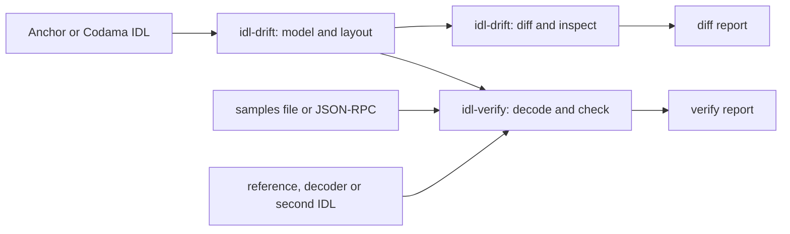

# Architecture

## Crates

The repository is a Cargo workspace with two crates. Each crate is a library and a binary.

| Crate | Main dependencies | Responsibility |
|---|---|---|
| `idl-drift` | `codama-nodes`, `serde`, `sha2`, `clap` | The IDL model, layouts, the diff rules and `inspect`. |
| `idl-verify` | `idl-drift`, `ureq`, `serde`, `clap` | Samples, live sampling, the runtime decoder, the checks and value comparison. |

Neither crate depends on the Solana SDK or on Anchor. Both tools read IDLs as JSON, and
idl-verify talks to a cluster over plain JSON-RPC.

## Parts

| Crate | Part | What it does |
|---|---|---|
| `idl-drift` | IDL model | One flat model for each supported format. The Anchor reader calculates the discriminators of a legacy IDL from the names. The Codama reader uses the same `codama-nodes` version as Shipstern. A node that the model cannot express becomes a `Generic` type, which `inspect` reports. Some other nodes are read in a simpler form (see [idl-drift.md](idl-drift.md#inspect)). Optional fields have defaults, so an IDL that leaves out `writable: false` and one that writes it compare equal. |
| `idl-drift` | Layout | Calculates the Borsh size of a type and the `repr(C)` layout of a zero-copy type, with SBF alignment rules. When the IDL does not fix a layout (an option, vec, enum, generic or `repr(Rust)` inside a zero-copy type), it returns an error, not a guess. Both tools use it. |
| `idl-drift` | Diff rules | Finds the reachable types, compares the two IDLs by name and by position, and gives each change a severity and a `kind`. When the formats differ, it first brings both IDLs to the same names and shapes. |
| `idl-drift` | Inspect | Lists `Generic` fields, prints zero-copy layouts, and finds padded zero-copy types that Borsh also reads. |
| `idl-verify` | Samples | Loads and saves the samples file. |
| `idl-verify` | Live sampler | Reads the program's transactions and accounts over JSON-RPC. It tracks the invoke stack, so that a log line is credited only to the innermost running program. |
| `idl-verify` | Runtime decoder | Decodes bytes with the IDL model alone: Borsh types in order, zero-copy types at their `repr(C)` offsets. It returns the value and the number of bytes it read. |
| `idl-verify` | Checks | Classifies each sample by discriminator (or by size, for an account type with no discriminator), decodes it, and runs each check. |
| `idl-verify` | Value comparison | Compares its own decode with a reference file, a decoder under test, or a second IDL. It first removes differences in how decoders write the same value, such as wrappers, big integer forms and field name case. |
| both | CLI and report | Parse the options, print the human or JSON report, and set the exit code from `--fail-on`. |

## Design decisions

- **One model, two formats.** A rule or a check works the same for Anchor and Codama IDLs,
  and `diff` can compare an Anchor IDL with a Codama IDL.
- **Rules follow the parser.** A change is Breaking when a parser generated from the old IDL
  reads the wrong bytes. The reference is Shipstern's generated parsers and its Anchor to
  Codama converter.
- **A runtime decoder, not generated code.** idl-verify does not need Shipstern or a code
  generator, and it can check any IDL that the model reads.
- **Bytes used is the main check.** A round trip (decode, then encode) is not a useful
  check. With fixed-size fields, it copies the same bytes in the same order, so a shifted
  read still round-trips. A count of the bytes that the IDL reads finds missing fields and
  missing padding.
- **Sample from transactions, not from `getProgramAccounts`.** `getProgramAccounts` has no
  limit, and with a discriminator filter it never returns an account type that the IDL does
  not have. Accounts that real transactions pass have neither problem.
- **No pass on missing data.** A run that cannot read its input, reach the RPC, or sample
  anything exits 2. It does not pass.
