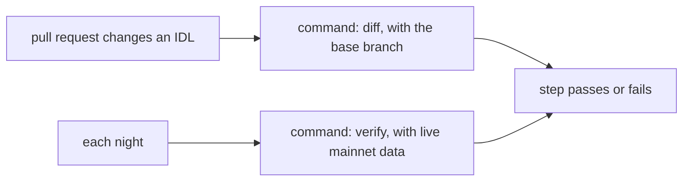

# CI with GitHub Actions

This repository is also a GitHub Action. In one step, it installs the tool and runs
`idl-drift diff`, `idl-drift source` or `idl-verify`. It writes a Markdown report to the job
summary and a JSON report to a file, and it fails the step on drift.



`idl-drift` finds a change that you make to the IDL. `idl-verify` finds a change that the
program makes without an IDL update.

## Example workflows

Copy one of the workflows in [`examples/github-actions/`](../examples/github-actions/) into
`.github/workflows/` of the repository that holds your IDLs, and put your IDL paths in
`matrix`.

| Workflow | Runs | Fails when |
|---|---|---|
| [`idl-drift-pr.yml`](../examples/github-actions/idl-drift-pr.yml) | On each pull request that changes a file under an `idls/` directory. | An IDL has a change at or above `fail-on` against the base branch. |
| [`idl-verify-nightly.yml`](../examples/github-actions/idl-verify-nightly.yml) | Each night at 03:17 UTC, and by hand. | Live mainnet data no longer matches your IDL, or your decoder under test. |

The smallest step diffs an IDL with the same file on the base branch of the pull request:

```yaml
- uses: actions/checkout@3d3c42e5aac5ba805825da76410c181273ba90b1 # v7.0.1
- uses: senzenn/idl-drift@v0.2.0
  with:
    idl: idls/my_program.json
```

## Inputs

| Input | Default | Meaning |
|---|---|---|
| `command` | `diff` | `diff` runs `idl-drift diff`. `verify` runs `idl-verify`. `source` runs `idl-drift source` on the workspace: see [source](idl-drift.md#source). Give the workspace directory in `args` when it is not the current directory. |
| `idl` | none | Path of the new IDL. Required for `diff` and `verify`. `source`: one more IDL to check (`--idl`). The path must resolve to a file in the workspace, also through a symlink. |
| `old` | the base branch | `diff`: path of the old IDL. By default, the action reads the file at the same path on the base branch of the pull request with `git show`. When the base branch has no such file, the step passes with a notice. On other events, set `old` or `program`. |
| `program` | none | `diff`: compare with the IDL that this program publishes on chain (`--onchain`), in place of `old`. `verify`: the program to sample (`--program`). |
| `rpc-url` | none | The JSON-RPC URL for `program` with `diff`, and for `verify`. With `source`, it turns on `--onchain`. See [RPC URL](#rpc-url). |
| `fail-on` | `breaking`, `error` | The lowest tier (`diff` and `source`) or severity (`verify`) that fails the step. |
| `allow` | none | Path of an allow file: see [idl-drift](idl-drift.md#allow-file) and [idl-verify](idl-verify.md#allow-file). `source` takes no allow input. The path must resolve to a file in the workspace. |
| `args` | none | More options, separated by spaces, such as `--min-coverage 50` or `--decoder target/release/verify-decoder`. The action does not expand quotes, globs or variables in them. |
| `version` | the action's ref | The idl-drift tag or commit SHA to install. |

## Outputs

| Output | Content |
|---|---|
| `exit-code` | The exit code of the tool. |
| `counts` | The `counts` object of the JSON report, such as `{"errors":1,"warnings":0,"notes":2}`. Allowed items are not counted. |
| `report` | Path of the JSON report. Upload it as an artifact to keep it. |
| `samples` | `verify` with live sampling only: path of the samples that the run read. |

## Install

When `version` is a tag with a release, the action downloads the release archive for the
runner (Linux or macOS, x86_64 or arm64), and checks it against the `.sha256` file of the
release. It stops when the two do not agree. For other versions and other runners, it
builds the tool with `cargo install --locked --git`, which needs Rust on the runner.
GitHub-hosted runners have Rust.

For stable results, pin the action to a full commit SHA, and set `version` to the tag of
that commit, so that the action downloads the release binary:

```yaml
- uses: senzenn/idl-drift@<full commit SHA> # v0.2.0
  with:
    version: v0.2.0
    idl: idls/my_program.json
```

## Job results

| Step result | Cause | What to do |
|---|---|---|
| Passes | Exit 0: no change or finding at or above `fail-on`, other than allowed ones. The report can still list smaller changes, warnings and notes. | Nothing. |
| `IDL drift` | Exit 1. `diff`: at least one change at or above `fail-on`. `verify`: at least one error, such as an unknown discriminator, bytes that the IDL does not read, or values that differ between your parser and the IDL. | Read the job summary. The rules are in [idl-drift.md](idl-drift.md#tiers), the checks in [idl-verify.md](idl-verify.md#checks). To accept a change, add it to the allow file. |
| `Program id drift` | Exit 1. `source`: at least one finding at or above `fail-on`, for example an `Anchor.toml` or IDL id that is not the `declare_id!`. | Read the job summary. The findings are in [idl-drift.md](idl-drift.md#findings). `source` has no allow file. |
| `idl-drift could not run`, `idl-verify could not run` | Exit 2. A file could not be read, an input is wrong, the RPC failed or rate-limited after 5 attempts, the decoder did not start, or nothing of the program was sampled. | This is not a finding about the IDL. Fix the setup, or run the workflow again. |
| Timeout | The RPC is too slow for `--max-tx`. | Run again, or lower the sampling limits in `args`. |

## RPC URL

Providers put the API key in the URL. Keep it in a repository secret, and give the secret
to `rpc-url`:

```bash
gh secret set IDL_VERIFY_RPC_URL
```

```yaml
rpc-url: ${{ secrets.IDL_VERIFY_RPC_URL }}
```

The action masks the URL in the log, and gives it to the tool only in the
`IDL_VERIFY_RPC_URL` or `IDL_DRIFT_RPC_URL` environment variable, never on the command line.
Do not put the URL in `args`. Lower `max-parallel` in the matrix if your RPC plan
rate-limits parallel runs.

A live `verify` samples one time and saves the samples, so do not give `--save-samples` in
`args`. The Markdown report reads the saved samples. To run the same check again on your
machine, with no RPC, download the `samples` file and run:

```bash
idl-verify --idl idls/my_program.json --samples samples.json
```

GitHub stops scheduled workflows in a public repository after 60 days with no activity.

## Security

- IDL text can come from the author of a pull request. The Markdown report escapes it, and
  the action stops workflow commands while it prints the report to the log.
- The action passes each input to its script in an environment variable, not in the script
  text.
- A pull request from a fork gets no secrets. Run `verify` on `schedule` or
  `workflow_dispatch`, not on `pull_request_target`.
