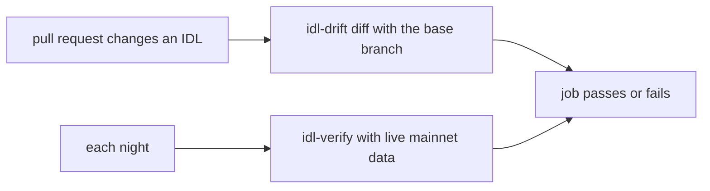

# CI with GitHub Actions

Two workflows in [`examples/github-actions/`](../examples/github-actions/) put both tools in
CI. Copy them into `.github/workflows/` of the repository that holds your IDLs.



| Workflow | Runs | Fails when |
|---|---|---|
| [`idl-drift-pr.yml`](../examples/github-actions/idl-drift-pr.yml) | On each pull request that changes a file under an `idls/` directory. | The new IDL has a change at or above `FAIL_ON` against the base branch. |
| [`idl-verify-nightly.yml`](../examples/github-actions/idl-verify-nightly.yml) | Each night at 03:17 UTC, and by hand. | Live mainnet data no longer matches your IDL, or your decoder under test. |

`idl-drift` finds a change that you make to the IDL. `idl-verify` finds a change that the
program makes without an IDL update.

Both workflows install the tools from source with `cargo install --git`. To get the same
results on each run, set `IDL_DRIFT_REV` to an idl-drift commit SHA.

## idl-drift on pull requests

Setup:

1. Copy `idl-drift-pr.yml` to `.github/workflows/idl-drift-pr.yml`.
2. Keep your IDLs as `.json` files in a directory named `idls/`, at any depth. To use
   another path, change `paths` under `on.pull_request` and the glob in the
   `Diff changed IDLs` step.
3. Optional: set `FAIL_ON` to `dangerous`, `additive` or `cosmetic` to fail on smaller
   changes too.

The workflow needs no secrets.

For each changed IDL, the job gets the base version with
`git show origin/<base branch>:<path>` and runs `idl-drift diff <base> <head>`. It prints
each change in the log, and uploads the JSON reports as the artifact `idl-drift-reports`.
A new IDL gets a notice, a removed IDL gets a warning, and a renamed IDL is compared with
its old path. The job checks each changed IDL before it fails, so one run shows all of them.

On exit 1 the job fails with `IDL drift` on the file. On exit 2 it fails with
`idl-drift could not run`.

To accept a known change, filter the JSON report by `kind` and `subject`. See
[idl-drift.md](idl-drift.md#json-output).

## idl-verify every night

The job samples recent mainnet transactions of each IDL's program, and checks the IDL
against them. With a decoder under test, it also compares your parser's values with the IDL.

Setup:

1. Copy `idl-verify-nightly.yml` to `.github/workflows/idl-verify-nightly.yml`.
2. Put your IDL paths in `matrix.idl`. Each IDL runs as its own job. idl-verify samples the
   program at the IDL's `address`.
3. Add your RPC URL as a repository secret. The workflow gives it to idl-verify only
   through the `IDL_VERIFY_RPC_URL` environment variable, never on the command line.

   ```bash
   gh secret set IDL_VERIFY_RPC_URL
   ```

4. Optional: to test a generated parser too, set `DECODER_BIN` to the name of its bin
   target, such as `verify-decoder`. If that bin is not in the package at the repository
   root, set `DECODER_PACKAGE` to the package name. To write this bin, see
   [decoder-protocol.md](decoder-protocol.md).
5. Optional: set `MIN_COVERAGE` to fail a run that samples too little. The minimum applies
   to each kind of IDL item: account types, instructions and events. A program that emits
   no events fails a minimum above 0 if its IDL lists events.
6. Run the workflow one time by hand: Actions, idl-verify nightly, Run workflow.

The `build` job installs `idl-verify` and builds the decoder one time. The `verify` jobs run
4 at a time. Lower `max-parallel` if your RPC plan rate-limits parallel requests.

Each IDL uploads an artifact `idl-verify-<path>`, such as `idl-verify-idls-my_program`. It
holds `report.json`, the JSON report, and `samples.json`, the samples of the run. To run the
same check again on your machine, with no RPC:

```bash
idl-verify --idl idls/my_program.json --samples samples.json
```

| Job result | Cause | What to do |
|---|---|---|
| Passes | idl-verify exit 0: no errors. Warnings and notes can be in the report. | Nothing. |
| `IDL drift` | idl-verify exit 1: at least one error, such as an unknown discriminator, bytes that the IDL does not read, or values that differ between your parser and the IDL. | Read the findings in the log or in `report.json`. The checks are in [idl-verify.md](idl-verify.md#checks). |
| `idl-verify could not run` | idl-verify exit 2. The secret is not set, the RPC failed or rate-limited after 5 attempts, the decoder did not start or answered badly, or nothing of the program was sampled. | This is not a finding about the IDL. Fix the setup, or run the workflow again. |
| Timeout after 30 minutes | The RPC is too slow for `--max-tx`. | Run again, or lower the sampling limits. |

GitHub stops scheduled workflows in a public repository after 60 days with no activity.

For a stricter run, add options to the `args` array in the `Run idl-verify` step:
`--fail-on warning` to fail on warnings too (see [limitations](idl-verify.md#limitations)),
or `--max-tx 400 --stall 150` to sample rare instructions, with more RPC requests.
