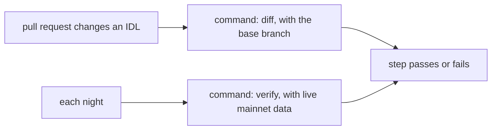

# CI with GitHub Actions

This repository is also a GitHub Action. In one step, it installs the tool and runs
`idl-drift diff`, `idl-drift source`, `idl-verify` or `idl-drift watch`. It writes a Markdown report to the job
summary and a JSON report to a file, and it fails the step on drift.



`idl-drift` finds a change that you make to the IDL. `idl-verify` finds a change that the
program makes without an IDL update.

## Example workflows

Copy one of the workflows in [`examples/github-actions/`](../examples/github-actions/) into
`.github/workflows/` of the repository that holds your IDLs, and put your IDL paths in
`matrix`.

| Workflow | Runs | Fails when |
|---|---|---|
| [`idl-drift-pr.yml`](../examples/github-actions/idl-drift-pr.yml) | On each pull request that changes a file under an `idls/` directory. | An IDL has a change at or above `fail-on` against the base branch. |
| [`idl-verify-nightly.yml`](../examples/github-actions/idl-verify-nightly.yml) | Each night at 03:17 UTC, and by hand. | Live mainnet data no longer matches your IDL, or your decoder under test. |
| [`idl-watch.yml`](../examples/github-actions/idl-watch.yml) | Each hour, and by hand. | A program could not be checked, or a pull request or issue could not be opened. A change opens a pull request or an issue. See [IDL update bot](#idl-update-bot). |

The smallest step diffs an IDL with the same file on the base branch of the pull request:

```yaml
- uses: actions/checkout@3d3c42e5aac5ba805825da76410c181273ba90b1 # v7.0.1
- uses: senzenn/idl-drift@v0.3.1
  with:
    idl: idls/my_program.json
```

## Inputs

| Input | Default | Meaning |
|---|---|---|
| `command` | `diff` | `diff` runs `idl-drift diff`. `verify` runs `idl-verify`. `source` runs `idl-drift source` on the workspace: see [source](idl-drift.md#source). Give the workspace directory in `args` when it is not the current directory. `watch` runs the [IDL update bot](#idl-update-bot). |
| `idl` | none | Path of the new IDL. Required for `diff` and `verify`. `source`: one more IDL to check (`--idl`). The path must resolve to a file in the workspace, also through a symlink. |
| `old` | the base branch | `diff`: path of the old IDL. By default, the action reads the file at the same path on the base branch of the pull request with `git show`. When the base branch has no such file, the step passes with a notice. On other events, set `old` or `program`. |
| `program` | none | `diff`: compare with the IDL that this program publishes on chain (`--onchain`), in place of `old`. `verify`: the program to sample (`--program`). |
| `rpc-url` | none | The JSON-RPC URL for `program` with `diff`, and for `verify`. With `source`, it turns on `--onchain`. See [RPC URL](#rpc-url). |
| `fail-on` | `breaking`, `error` | The lowest tier (`diff` and `source`) or severity (`verify`) that fails the step. |
| `allow` | none | Path of an allow file: see [idl-drift](idl-drift.md#allow-file) and [idl-verify](idl-verify.md#allow-file). `source` takes no allow input. The path must resolve to a file in the workspace. |
| `programs` | none | `watch`: path of the programs file, one `<program> <local IDL path> [metadata|anchor]` per line. Required for `watch`. It must resolve to a file in the workspace. |
| `state` | none | `watch`: path of the state file that keeps the slots of the last run. Keep it between runs, for example with `actions/cache`. Its directory must be in the workspace. |
| `token` | `github.token` | `watch`: the token that `gh` uses. Other commands get no token. In `watch`, the environment of the run step holds the token, and only `gh` uses it. |
| `args` | none | More options, separated by spaces, such as `--min-coverage 50` or `--decoder target/release/verify-decoder`. The action does not expand quotes, globs or variables in them. |
| `version` | the action's ref | The idl-drift tag or commit SHA to install. |

## Outputs

| Output | Content |
|---|---|
| `exit-code` | The exit code of the tool. |
| `counts` | The `counts` object of the JSON report, such as `{"errors":1,"warnings":0,"notes":2}`. Allowed items are not counted. |
| `report` | Path of the JSON report. Upload it as an artifact to keep it. `watch`: path of the events, one JSON object per line. |
| `samples` | `verify` with live sampling only: path of the samples that the run read. |

## Install

When `version` is a tag with a release, the action downloads the release archive for the
runner (Linux or macOS, x86_64 or arm64), and checks it against the `.sha256` file of the
release. It stops when the two do not agree. For other versions and other runners, it
builds the tool with `cargo install --locked --git`, which needs Rust on the runner.
GitHub-hosted runners have Rust.

For stable results, pin the action to a full commit SHA, and set `version` to the tag of
that commit, so that the action downloads the release binary:

```yaml
- uses: senzenn/idl-drift@<full commit SHA> # v0.3.1
  with:
    version: v0.3.1
    idl: idls/my_program.json
```

## Job results

| Step result | Cause | What to do |
|---|---|---|
| Passes | Exit 0: no change or finding at or above `fail-on`, other than allowed ones. The report can still list smaller changes, warnings and notes. | Nothing. |
| `IDL drift` | Exit 1. `diff`: at least one change at or above `fail-on`. `verify`: at least one error, such as an unknown discriminator, bytes that the IDL does not read, or values that differ between your parser and the IDL. | Read the job summary. The rules are in [idl-drift.md](idl-drift.md#tiers), the checks in [idl-verify.md](idl-verify.md#checks). To accept a change, add it to the allow file. |
| `Program id drift` | Exit 1. `source`: at least one finding at or above `fail-on`, for example an `Anchor.toml` or IDL id that is not the `declare_id!`. | Read the job summary. The findings are in [idl-drift.md](idl-drift.md#findings). `source` has no allow file. |
| `idl-drift could not run`, `idl-verify could not run` | Exit 2. A file could not be read, an input is wrong, the RPC failed or rate-limited after 5 attempts, the decoder did not start, or nothing of the program was sampled. | This is not a finding about the IDL. Fix the setup, or run the workflow again. |
| Timeout | The RPC is too slow for `--max-tx`. | Run again, or lower the sampling limits in `args`. |

## IDL update bot

`command: watch` runs `idl-drift watch --once` on the programs file (see
[watch](idl-drift.md#watch)). For each program whose deploy or on-chain IDL changed since the
last run, the action compares the on-chain IDL with your local IDL:

| Highest change | What the action does |
|---|---|
| None | Nothing. The job summary lists the program. |
| Additive or Cosmetic | It writes the on-chain IDL (formatted with `jq .`) to the local path on a new branch `idl-drift/<program>-<key>`, pushes the branch, and opens a pull request to the branch of the run with `gh pr create`. The body has the Markdown diff. |
| Breaking or Dangerous | It opens an issue with the Markdown diff with `gh issue create`, because the parser needs a change before the IDL file. |

`<key>` is the first 12 hex digits of the sha256 of the on-chain IDL text. Any transaction
that names the IDL account moves its slot, but not its text, so the action opens each pull
request or issue only one time for one IDL. It skips a branch that has a pull request (open,
closed or merged), and an issue with the same title (open or closed). A branch with no pull
request is from a run whose `gh pr create` failed, so the action replaces it with a force
push. It replaces only branches under `idl-drift/`. A program deployed after its last IDL
write also gets a `Stale on-chain IDL` warning.

`idl-drift watch` writes a copy of the state. The action copies the entry of a program to the
`state` file only after its pull request or issue, so the next run tries a failed one again.

The job needs write permissions:

```yaml
permissions:
  contents: write
  pull-requests: write
  issues: write
```

```yaml
- uses: senzenn/idl-drift@main
  with:
    command: watch
    programs: idls/programs.txt
    state: .idl-watch/state.json
    rpc-url: ${{ secrets.IDL_DRIFT_RPC_URL }}
```

- In the repository settings, turn on *Allow GitHub Actions to create and approve pull
  requests*, else `gh pr create` fails.
- GitHub starts no workflow for a pull request that `github.token` opens. For CI on the bot's
  pull requests, give a GitHub App token or a fine-grained token to `token`, and to
  `actions/checkout`, which keeps the credentials that the push uses.
- Run the job on `schedule` or `workflow_dispatch`, from the branch that the pull requests
  go to.
- The commit leaves the checkout and its index as they are, so later steps see the files
  of the run.

The step fails (exit 2) when a program could not be checked, or a pull request or issue
could not be opened. The other programs still get their pull request or issue.

## RPC URL

Providers put the API key in the URL. Keep it in a repository secret, and give the secret
to `rpc-url`:

```bash
gh secret set IDL_VERIFY_RPC_URL
```

```yaml
rpc-url: ${{ secrets.IDL_VERIFY_RPC_URL }}
```

The action masks the URL in the log, and gives it to the tool only in the
`IDL_VERIFY_RPC_URL` or `IDL_DRIFT_RPC_URL` environment variable, never on the command line.
Do not put the URL in `args`. Lower `max-parallel` in the matrix if your RPC plan
rate-limits parallel runs.

A live `verify` samples one time and saves the samples, so do not give `--save-samples` in
`args`. The Markdown report reads the saved samples. To run the same check again on your
machine, with no RPC, download the `samples` file and run:

```bash
idl-verify --idl idls/my_program.json --samples samples.json
```

GitHub stops scheduled workflows in a public repository after 60 days with no activity.

## Security

- IDL text can come from the author of a pull request. The Markdown report escapes it, and
  the action stops workflow commands while it prints the report to the log.
- The action passes each input to its script in an environment variable, not in the script
  text.
- A pull request from a fork gets no secrets. Run `verify` on `schedule` or
  `workflow_dispatch`, not on `pull_request_target`.
- The CI of this repository runs `scripts/test-action.sh`. It runs the action script on small
  workspaces, and checks that control characters reach the log as `?`, that an `idl`,
  `allow` or `programs` path outside the workspace stops the step, and the `exit-code`
  output. For `watch`, a fake `gh` records each call, and a local bare repository takes the
  push.
- `watch` writes only to local IDL paths in the workspace, and puts only checked program
  ids and slots in branch names and titles.
