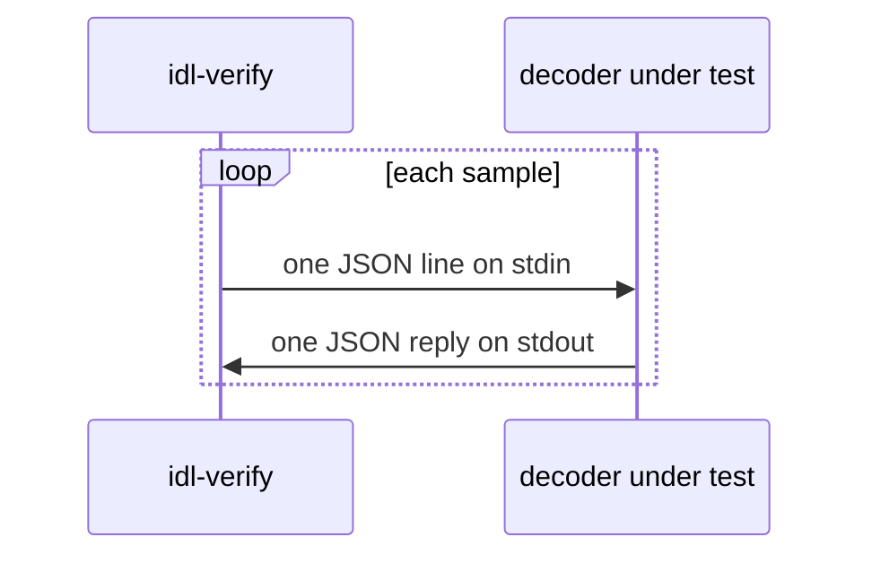

# Decoder protocol

`idl-verify --decoder "<command>"` compares the IDL with a **decoder under test**: a program
that you supply, such as a binary built from a generated parser. idl-verify sends each
sample to the decoder, and compares each reply with its own decode of the same bytes from
the IDL. Use this mode to find the bugs that a generated parser adds on top of the IDL, and
the bugs in the IDL that the parser copies.



## Run

```bash
idl-verify --idl idl.json --samples samples.json --decoder "./target/release/my-decoder spl_governance"
```

idl-verify splits the command on whitespace. The first word is the program, and the other
words are its arguments. There is no shell, so quotes and pipes have no special meaning.
`--decoder` works with `--samples` and with live sampling.

## Requests

idl-verify writes one line for each sample to the decoder's stdin: first all accounts, then
all instructions, then all events. Then it closes stdin.

```json
{"kind":"account","program":"<base58>","address":"<base58>","data":"<base64>"}
{"kind":"instruction","program":"<base58>","signature":"<base58>","data":"<base64>","accounts":["<base58>", "..."]}
{"kind":"event","program":"<base58>","signature":"<base58>","source":"log","data":"<base64>"}
```

| Field | Content |
|---|---|
| `kind` | `account`, `instruction` or `event`. |
| `program` | The program id: `--program`, else the samples' `programId`, else the IDL's `address`. |
| `address` | The account address. Can be empty when the samples file has none. |
| `signature` | The transaction signature. Can be empty when the samples file has none. |
| `data` | The raw bytes, base64. For an account: the full account data. For an instruction: the instruction data. For an event: `[discriminator][payload]`. idl-verify removes a self-CPI envelope first. |
| `accounts` | The instruction's account keys, in order. |
| `source` | `log` for a `Program data:` line, `cpi` for a self-CPI event. |

## Replies

The decoder writes one line to stdout for each request, in the same order. Empty lines are
ignored. Each reply is one of these:

```json
{"status":"ok","value":<decoded value>}
{"status":"error","error":"<message>"}
{"status":"skip","reason":"<message>"}
```

| Status | Meaning | Result in the report |
|---|---|---|
| `ok` | The decoder decoded the sample. | idl-verify compares `value` with its own decode. A difference is an error (`reference` check). |
| `error` | The decoder rejected the sample. | An error when the IDL decodes the same bytes. |
| `skip` | The decoder does not decode this kind of sample, such as a parser built without events. | A note. |

A decoder that answers `skip` to each request passes with exit 0 and only notes. Look at
the notes, or the `reference` counts in the JSON report, to make sure that values were
compared.

### Value shapes

For an account, `value` is the decoded account: an object with one key for each field.
For an instruction or an event, `value` is `{"name":"<name>","data":{...}}`. `name` is the
instruction or event name. `data` holds the arguments or the event fields. An instruction
with one struct argument can return the struct itself as `data`, as Shipstern does.

Write values in serde's plain JSON shapes. idl-verify accepts these forms:

| Value | Accepted forms |
|---|---|
| Integer, up to 32 bits | A JSON number. |
| Integer, 64 bits or wider | A JSON number, a decimal string, or `{"bn":"<decimal>"}`. Use a string or `{"bn":...}` for a value that does not fit in a `u64`. |
| Pubkey | A base58 string, or an array of its 32 bytes, as serde writes a `Pubkey`. |
| Bytes | An array of numbers. |
| Option | `null` for `None`, else the inner value. |
| Struct | An object. Field names compare without case and without underscores, so `last_updated_epoch` matches `lastUpdatedEpoch`. A Shipstern tuple field `item_0` matches `0`. |
| Tuple | An array, or an object with keys `"0"`, `"1"`, ... |
| Enum | `{"<Variant>": <payload>}`. A unit variant can also be a bare string, `"<Variant>"`. Shipstern's `{"kind": ...}` wrapper is accepted. |
| Map | An array of `[key, value]` pairs. |
| Wrappers | A one-field wrapper around a value, and a type-name wrapper such as `{"Pool": {...}}`, are accepted. |

## Errors and timeouts

The run exits 2 in these cases:

- The command cannot start.
- The decoder writes a line that is not JSON, or a reply with no `status`.
- The decoder closes stdout before it answers each request. The message gives the exit
  status and the number of replies.
- The decoder gives no reply within 60 seconds. idl-verify stops the decoder.

idl-verify writes requests on one thread and reads replies on another. A decoder can answer
each line as soon as it reads it.

## A minimal decoder

This Python decoder, `skip_decoder.py`, shows the framing. It skips each sample:

```python
import json, sys

for line in sys.stdin:
    request = json.loads(line)
    reply = {"status": "skip", "reason": f"{request['kind']} not decoded"}
    print(json.dumps(reply), flush=True)
```

```bash
idl-verify --idl fixtures/live/jupiter_vaults/idl.json \
           --samples fixtures/live/jupiter_vaults/samples.json \
           --decoder "python3 skip_decoder.py"
```

```text
note: instruction operate: not compared: the decoder under test skipped 12 of 12 samples: instruction not decoded
...
summary: 0 errors, 0 warnings, 13 notes
```

A decoder that returns wrong values gets an error for each type:

```text
error: account Branch: values differ from the decoder under test in 1 of 1 sample: idl-verify read {"branch_id":1,"connected_branch_id":0,"connected_minima_tic..., the decoder under test {"bump":0}
  hint: one of the two decoders misreads these bytes; check the field's type and offset
```

To run this check each night, see [ci.md](ci.md#example-workflows).
